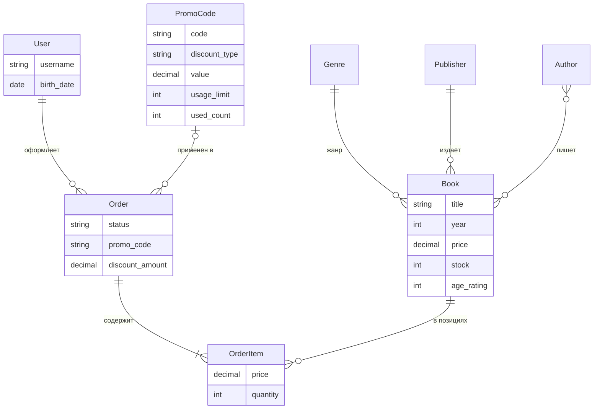

# Bookshop: интернет-магазин книг

Учебный проект: веб-приложение на Django (шаблоны, SQLite).
Вариант **Д1-М2**: книжный магазин + промокоды и скидки.

## О проекте

Магазин продаёт книги. Покупатель выбирает книги в каталоге, кладёт их в корзину, при желании применяет промокод и оформляет заказ. Менеджер обрабатывает заказы в admin panel.

**Особое правило магазина (Д1).** У каждой книги есть возрастная маркировка (0+, 6+, 12+, 16+, 18+), у пользователя есть дата рождения. Книги 18+ нельзя заказать, если дата рождения не указана или покупателю меньше 18 лет. В этом случае показывается понятное сообщение, заказ не создаётся.

**Модуль (М2).** Промокоды дают скидку (процентом или фиксированной суммой). У промокода есть период действия, лимит использований и минимальная сумма заказа. Код и сумма скидки сохраняются в заказе.

## Роли

| Роль | Что может |
| --- | --- |
| Гость | Смотреть каталог, искать и фильтровать книги, регистрироваться и входить |
| Покупатель | Всё, что гость, плюс корзина, промокоды, оформление и отмена заказов, личный кабинет |
| Менеджер | Работает в admin panel: управляет каталогом, ведёт заказы, меняет их статусы, создаёт промокоды |
| Администратор | Полный доступ, управление пользователями и группами |

## Сценарии

1. Гость может смотреть каталог, искать книги по названию и фильтровать по жанру, автору и году издания.
2. Гость может зарегистрироваться и войти в личный кабинет.
3. Покупатель может добавить книгу в корзину, если она есть в наличии.
4. Покупатель может применить промокод в корзине и увидеть размер скидки.
5. Покупатель получает понятное сообщение, если промокод просрочен, исчерпан или сумма заказа меньше минимальной.
6. Покупатель может оформить заказ, при этом остатки книг на складе уменьшаются.
7. Покупатель не может заказать книгу 18+, если не указал дату рождения или ему нет 18 лет.
8. Покупатель может посмотреть историю заказов и отменить заказ, пока он новый.
9. Менеджер может добавлять книги и менять остатки в admin panel.
10. Менеджер может переводить заказы по статусам и создавать промокоды.

## Модели

| Модель | Поля | Связи |
| --- | --- | --- |
| User | username, email, пароль, birth_date | своя модель пользователя (наследует AbstractUser) |
| Genre | name | жанр, у него много книг |
| Author | name | автор, связан с книгами многие-ко-многим |
| Publisher | name | издательство, у него много книг |
| Book | title, year, description, price, stock, age_rating (choices), cover, is_active | FK на Genre и Publisher, M2M на Author |
| PromoCode | code, discount_type (choices), value, valid_from, valid_to, usage_limit, used_count, min_order_amount, is_active | используется в заказах |
| Order | status (choices), full_name, phone, address, comment, promo_code, discount_amount, created_at | FK на User, FK на PromoCode (может быть пустым) |
| OrderItem | price (на момент заказа), quantity | FK на Order, FK на Book |

Ограничения на уровне базы: цена книги не отрицательная, издание уникально (название, издательство, год), у промокода скидка больше нуля, процент не больше 100, использований не больше лимита, количество в позиции заказа не меньше 1.

## Схема базы данных



## Запуск проекта

Команды для Windows (PowerShell):

```powershell
git clone https://github.com/karyuginavaleria-web/bookshop.git
cd bookshop
py -m venv venv
venv\Scripts\Activate.ps1
python -m pip install -r requirements.txt
python manage.py migrate
python manage.py runserver
```

Сайт откроется по адресу http://127.0.0.1:8000/.
Команда `seed_demo` и демонстрационные пользователи будут добавлены позже.